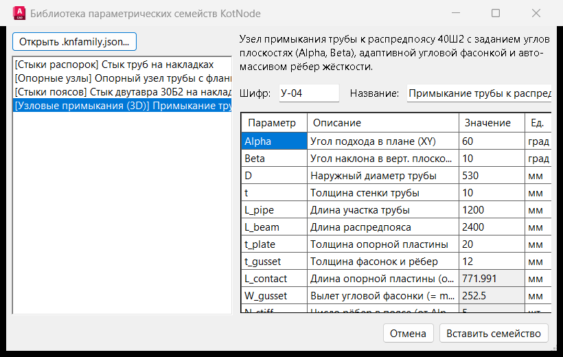
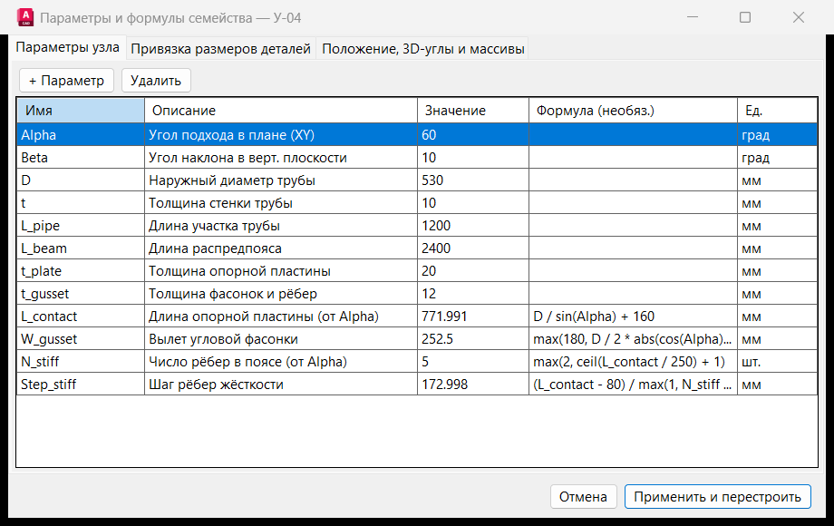
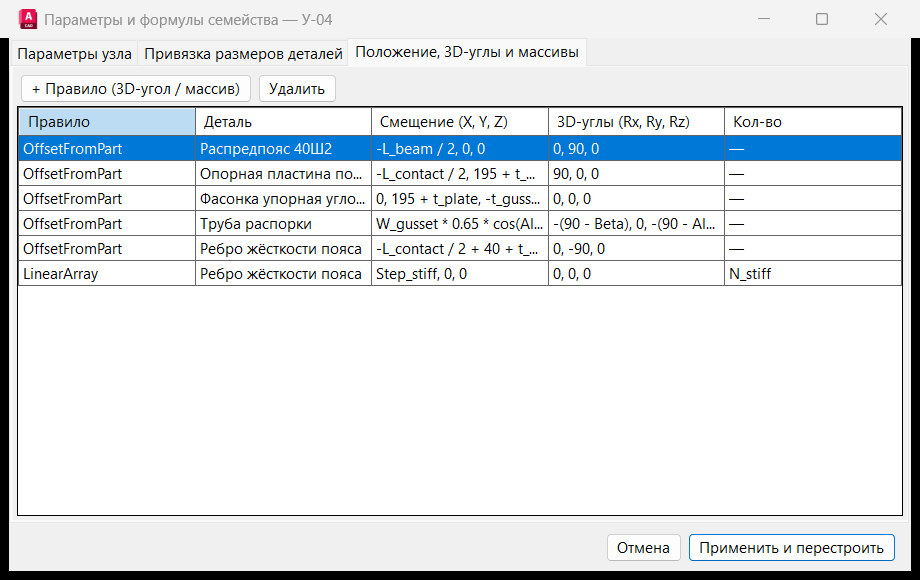
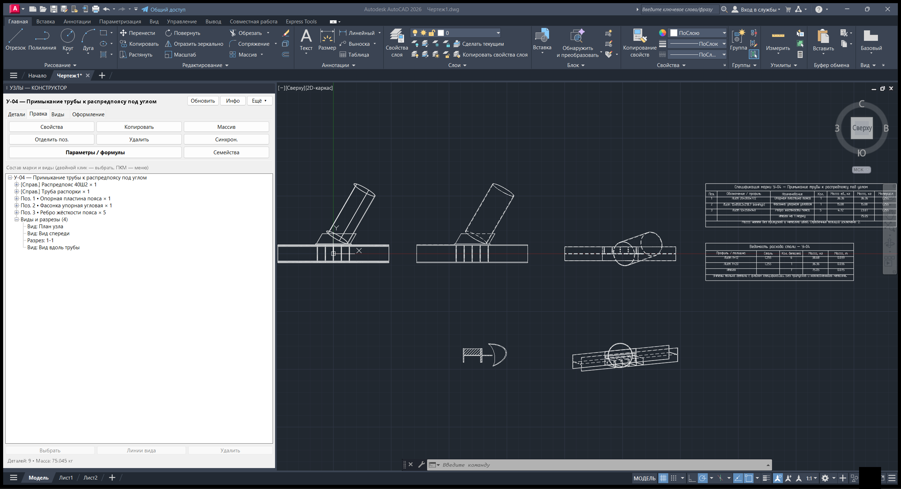
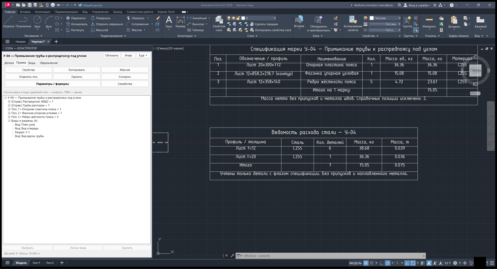
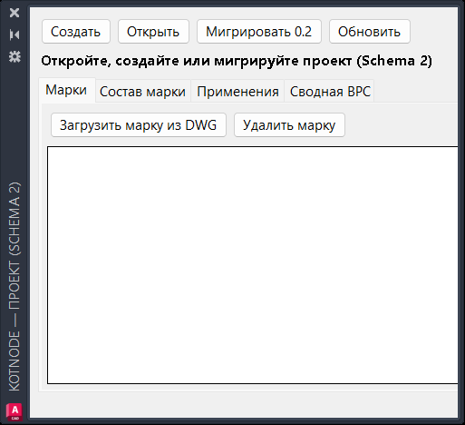

# История разработки KotNode

Документ фиксирует полную хронологию развития **KotNode** — от исходной базы `0.2.1` (диспетчер проектов для одного типового узла «труба–труба») до полноценного **конструктора параметрических семейств узлов и чертежей КМ/КМД в AutoCAD (Windows x64)** со всеми видами, разрезами, сварными швами, ассоциативным оформлением, спецификациями и ведомостью расхода стали (ВРС) в пространстве Модели `1:1`.

---

## Исходная цель и архитектурные принципы

- **Среда исполнения:** AutoCAD 2021–2026 (Windows x64, плагин `.NET Framework 4.8`), CAD-независимое ядро `KotNode.Core` (`net48` + `net8.0`).
- **Строго в пространстве Модели (1:1):** 3D-сборка, 2D-виды, разрезы, сварные швы, размеры, выноски, спецификации и ВРС создаются нативными примитивами AutoCAD в миллиметрах без `FLATSHOT`, HLR AutoCAD и Open CASCADE.
- **Семантическая стабильность:** правки линий, швы и оформление привязаны к устойчивым семантическим идентификаторам деталей и кромок `(InstanceId, SourceKey, t)`, а не к координатам или DWG Handle — поэтому переживают изменение параметров, 3D-углов и `NAUPDATEVIEW`.
- **Никакого программирования при создании новых узлов:** формулы, 3D-углы стыковки, параметрические контуры фасонок, круговые/линейные массивы и шаблоны семейств `.knfamily.json` настраиваются через GUI.

---

## Этапы реализации (хронология)

### Базовая линия и универсальное ядро (Этапы 0–3)
*Коммиты `e792f16` → `859f6b6`*

- Импортирована база `KotNode 0.2.1` с оракулом LISP 0.7 (`97 550` чертёжных проверок).
- Создано CAD-независимое универсальное ядро `AssemblyMark` / `AssemblyProject` (Schema 2) с 6 типами деталей:
  1. `Pipe` — круглая труба;
  2. `RectangularPlate` — прямоугольный лист;
  3. `PolygonPlate` — контурный лист с произвольными многоугольными и круглыми отверстиями;
  4. `CurvedPlate` — криволинейная накладка (сектор цилиндра);
  5. `IBeam` — двутавры по ГОСТ 35087-2024 (с радиусами сопряжения `RootRadius`);
  6. `Rebar` — арматурные стержни с плоскими и 3D-пространственными гибами.
- Реализовано транзакционное хранение марки в DWG, восстановление пропавших деталей (`NAREPAIR`), дерево состава, вспомогательная графика (`NAAUX`), копирование и массивы.
- Подтверждена миграция legacy-проектов `0.2.1` → Schema 2 без перезаписи исходного файла (`144` проверки сборок и конкурентного сохранения).

### Поиск и переход на параметрические проекции (Этап 4, генераторы 1–14)
*Коммиты `86d4d52` → `1445a48`*

- Проведены эксперименты с нативным HLR Bridge и `FLATSHOT`, которые выявили неустойчивость нативного HLR и потерю семантики кромок.
- Создан собственный расчётный движок **прямых параметрических проекций и разрезов** (`ParametricProjection` + `SpatialProjection`) по 3D-базе марки:
  - произвольные плоскости видов по 3 точкам (`ThreePoints`) и привязка плоскости к экземпляру детали (`FrameAnchorId`);
  - явные замкнутые контуры штриховки (`SectionHatchBoundary`);
  - постоянный внешний контейнер вида `NA_VIEW_SHELL` с защитой ручных правок пользователя (`ViewShell` + `ViewGeometryStamp`);
  - журнал переопределений видимости линий и участков (`ViewLineOverrides`).

### Этап 4.1 — Надёжное редактирование линий, двутавры с галтелями, арматура и сварные швы (генераторы 15–17)
*Коммиты `6d77018`, `58ec828`, `f80d43f`*

- **`6d77018` (генератор 15):**
  - `NALINEEDIT` полностью переведён с хрупкого `GetNestedEntity` (вызывавшего `eWasErased` на вложенных блоках в AutoCAD 2025/2026) на прямой бестранзакционный геометрический выбор по `ViewLineOverrides.Pick` с живой подсветкой `TransientManager`, переключением режимов (`Visible`/`Hidden`/`Suppress`/`Auto`, `Segment`/`Fragment`/`Edge`) и `Undo` на лету.
  - Обеспечено 100% покрытие `SourceKey` в пространственном маршруте, склейка фасетированных дуг в единую `Polyline` (`Plinegen = true`), ГОСТ-штриховая `NA_DASHED (4/-2)` и `RecordGraphicsModified(true)`.
  - Переработана палитра `NACONSTRUCTOR` ([`src/AutoCAD/ConstructorPanel.cs`](../src/AutoCAD/ConstructorPanel.cs)): заголовок марки, 4 логические вкладки (`Детали`, `Правка`, `Виды`, `Оформление`), дерево состава с контекстным меню ПКМ и нижняя контекстная панель.
- **`58ec828` (генератор 16):**
  - В [`src/Core/SpatialProjection.cs`](../src/Core/SpatialProjection.cs) добавлены проекции и разрезы **двутавров ГОСТ 35087-2024 с галтелями (`RootRadius > 0`)** и **3D-арматуры (`Rebar`)** (прямые, плоские и 3D-пространственные гибы трубчатой оболочкой с параллельным переносом сечения).
- **`f80d43f` (генератор 17):**
  - Добавлена параметрическая графика сварных швов на видах ([`src/Core/ViewWelds.cs`](../src/Core/ViewWelds.cs), команды `NAWELD` / `NAWELDRESET`, слой `NA_WELD`): стили `Site` (крестики `×`), `Factory` (реснички `|`), `Hidden`, выбор стороны кликом и живое превью `TransientManager`.

### Этап 5 — Ассоциативное оформление видов (генератор 18)
*Коммит `adf7fc3`*

- Реализованы семантические якоря `ViewAnchor` ([`src/Core/ViewAnnotations.cs`](../src/Core/ViewAnnotations.cs)), нативный рендерер в Модели с шрифтом `ISOCPEUR` ([`src/AutoCAD/ViewAnnotationDrawing.cs`](../src/AutoCAD/ViewAnnotationDrawing.cs)) и команды [`src/AutoCAD/AnnotationCommands.cs`](../src/AutoCAD/AnnotationCommands.cs):
  - `NADIM` — ассоциативные размеры (сохраняют ручное смещение размерной линии);
  - `NAPOS` — ассоциативные выноски позиций (нативный `MLeader` с автообновлением номера позиции);
  - `NAWELDLEADER` — выноски сварных швов по ГОСТ 2.312 (катет `k`, монтажный флажок);
  - `NAAXIS` — осевые линии труб и отверстий;
  - `NASECTIONMARK` — обозначения разрезов `1-1` со стрелками;
  - `NAANNORESET` — очистка оформления вида.

### Этапы 6–7 — Универсальные спецификации, ВРС и диспетчер проекта Schema 2
*Коммит `92755a9`*

- Реализован расчёт спецификаций, локальной и сводной ВРС с исключением справочных позиций (`IncludeInSpec = false`) в [`src/Core/AssemblyReporting.cs`](../src/Core/AssemblyReporting.cs).
- Добавлены автообновляемые нативные таблицы AutoCAD в [`src/AutoCAD/AssemblyTableDrawing.cs`](../src/AutoCAD/AssemblyTableDrawing.cs): `NASPEC`, `NAVRS`, `NAUPDATETABLES`, `NAEXPORTCSV`.
- Создан диспетчер проекта Schema 2 ([`src/AutoCAD/AssemblyProjectPanel.cs`](../src/AutoCAD/AssemblyProjectPanel.cs)): `NPROJECT2`, `NAPROJIMPORT`, `NAPROJVRS`, `NAPROJUPDATE`, миграция проектов `0.2.1` → Schema 2, учёт применений по ярусам и сводная ВРС проекта.

### Этапы 8–9 — Параметрический решатель формул, 3D-углы стыковки и библиотека семейств
*Коммиты `3595afa`, `3b182cc`*

- **`3595afa`:**
  - Безопасный рекурсивно-нисходящий парсер формул и DAG-решатель с защитой от циклов ([`src/Core/ParametricEngine.cs`](../src/Core/ParametricEngine.cs)) + диалог `NAPARAMS` и команда `NASOLVE` ([`src/AutoCAD/ParametricCommands.cs`](../src/AutoCAD/ParametricCommands.cs)).
  - Библиотека параметрических семейств `.knfamily.json` ([`src/Core/NodeFamily.cs`](../src/Core/NodeFamily.cs), `NAFAMILY`, `NAFAMILYSAVE` в [`src/AutoCAD/FamilyCommands.cs`](../src/AutoCAD/FamilyCommands.cs)) со встроенными типовыми узлами.
- **`3b182cc` (многоплоскостные 3D-углы стыковки):**
  - Добавлены 3D-повороты по формулам (`ExprRotXDeg`, `ExprRotYDeg`, `ExprRotZDeg`), тригонометрические функции (`asin`/`acos`/`atan`/`atan2`), линейные массивы в опорной СК (`LinearArray`) и параметрические вершины контуров фасонок (`PolygonBinding`).
  - Добавлена 3-я вкладка в `NAPARAMS` («Положение, 3D-углы и массивы») и 4-е встроенное семейство **«Примыкание трубы к распредпоясу под углом» (`У-04`)** с углами в 2 плоскостях (`Alpha` в плане XY + `Beta` в вертикальной плоскости), адаптивной длиной опорной пластины `L_contact`, адаптивной угловой фасонкой `PolygonPlate`, автоматическим числом рёбер жёсткости `N_stiff` и видом вдоль наклонной трубы.

### E2E-тестирование в реальном AutoCAD 2026 и визуальная GUI-проверка через MCP
*Коммиты `9d9387e`, `ca3ebc4`, `f779c46`*

- **`9d9387e` (AutoCAD 2026 Core Console E2E):**
  - Написан сквозной автотест внутри реального движка AutoCAD 2026 (`accoreconsole.exe`) — команды `NAE2ETEST` и `NAE2ERELOAD` ([`src/AutoCAD/AutoCadSelfTest.cs`](../src/AutoCAD/AutoCadSelfTest.cs)).
  - Выявлен и исправлен баг сериализации `DataContractJsonSerializer` для `ViewAnnotationDrawing+AnnoTag` (класс сделан `public`). Пройдены оба прохода (`ALL_E2E_PASSED` и повторная загрузка сохранённого DWG `ALL_RELOAD_PASSED`).
- **`ca3ebc4` (Локальный MCP-сервер для AutoCAD GUI):**
  - Создан нативный `.NET 8.0-windows` MCP-сервер [`tools/AutoCadMcp/Program.cs`](../tools/AutoCadMcp/Program.cs) (COM + Windows UI Automation + `PrintWindow`), обеспечивающий запуск AutoCAD GUI, тихий `NETLOAD`, отправку команд, клики по вкладкам/кнопкам, работу с модальными окнами без блокировки и съёмку скриншотов.
- **`f779c46` (Визуальная проверка в живом GUI AutoCAD 2026 и исправление 6 дефектов):**
  - В ходе полного прохода по GUI AutoCAD 2026 были визуально обнаружены на скриншотах и немедленно исправлены 6 реальных UX/инженерных дефектов:
    1. **DPI-вёрстка `NAFAMILY`:** замена `SplitContainer` на пропорциональный `TableLayoutPanel` (`42% / 58%`), устранено обрезание поля «Название» и столбцов таблицы параметров при 125% DPI.
    2. **Разнесение таблиц Спецификации и ВРС:** расчёт координат таблиц переведён на фактические габариты `GeometricExtents` видов и таблиц — полностью исключено наложение таблиц.
    3. **Устранение ложного `[обновить]`:** синхронизация `AssemblyDrawing.Synchronize` перенесена до расчёта `SourceHash` в `NAFAMILY` и `NAPARAMS`.
    4. **Посадка трубы в `У-04`:** убран зазор между торцом наклонной трубы и угловой фасонкой.
    5. **Корректная группировка толщин листа в ВРС (`У-03`, `У-04`):** вертикальным рёбрам и накладкам задана реальная толщина проката `Thickness = 12 мм` с поворотом `ExprRotXDeg`/`ExprRotYDeg` — в ВРС фасонка и 5 рёбер суммируются в `Лист t=12` (`6 шт., 38.68 кг`) вместо ошибочного `Лист t=140`.
    6. **Ширина столбца «Масса ед., кг»:** заголовок в спецификации помещается в одну строку без касания рамки.

---

## Скриншоты верификации в AutoCAD 2026 GUI

### 1. Библиотека параметрических семейств (`NAFAMILY`)

### 2. Редактор параметров, формул и 3D-углов (`NAPARAMS`)

### 3. Вставленное 3D-семейство `У-04`, 4 вида и палитра `NACONSTRUCTOR`

### 4. Таблицы Спецификации и ВРС в пространстве Модели

### 5. Диспетчер проекта Schema 2 (`NPROJECT2`)

---

## Итоговый статус проверок

- **Сборка плагина (`net48`) и ядра (`net48` / `net8.0`):** `0` ошибок, `0` предупреждений (`build.ps1`).
- **Модульные и регрессионные тесты (`tests/KotNode.Tests.csproj`):**
  - `22` базовые проверки ядра и хранилища;
  - `152` проверки проекций, разрезов, двутавров с галтелями, 3D-арматуры, сварных швов, ассоциативного оформления, спецификаций/ВРС, формул/3D-углов и семейств;
  - `9` проверок границ штриховки + `9` проверок объединения ячеек таблиц;
  - `144` проверки универсальной модели сборок и миграции Schema 2;
  - `97 550` чертёжных проверок паритета с эталоном LISP 0.7.
- **Сквозной тест в AutoCAD 2026 Core Console (`NAE2ETEST` + `NAE2ERELOAD`):** `ALL_E2E_PASSED`, `ALL_RELOAD_PASSED`.
- **Визуальный ручной тест в AutoCAD 2026 GUI (`tools/AutoCadMcp`):** пройден полностью (`32/32` шагов).
